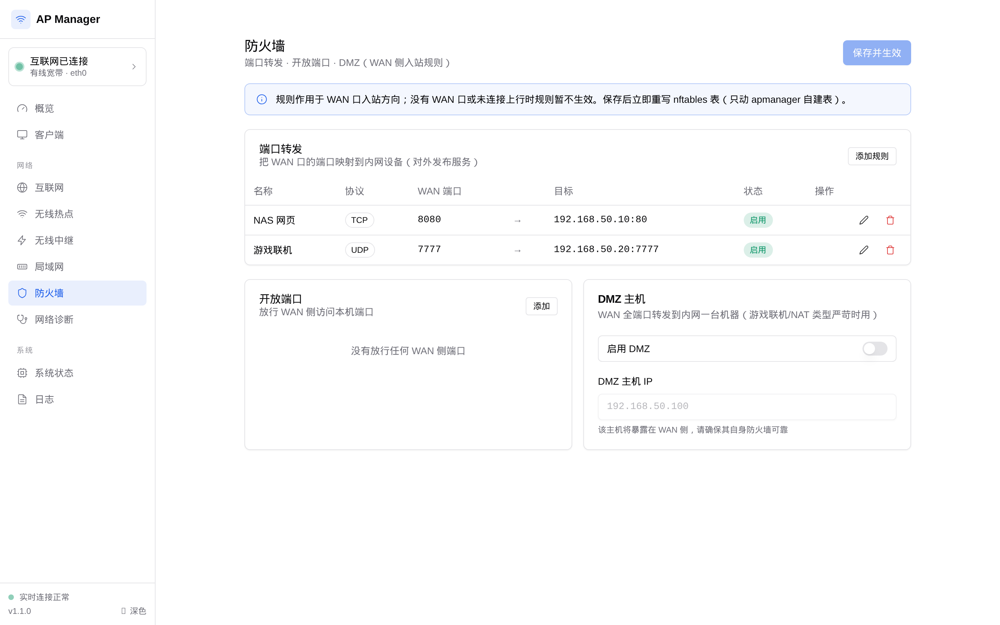
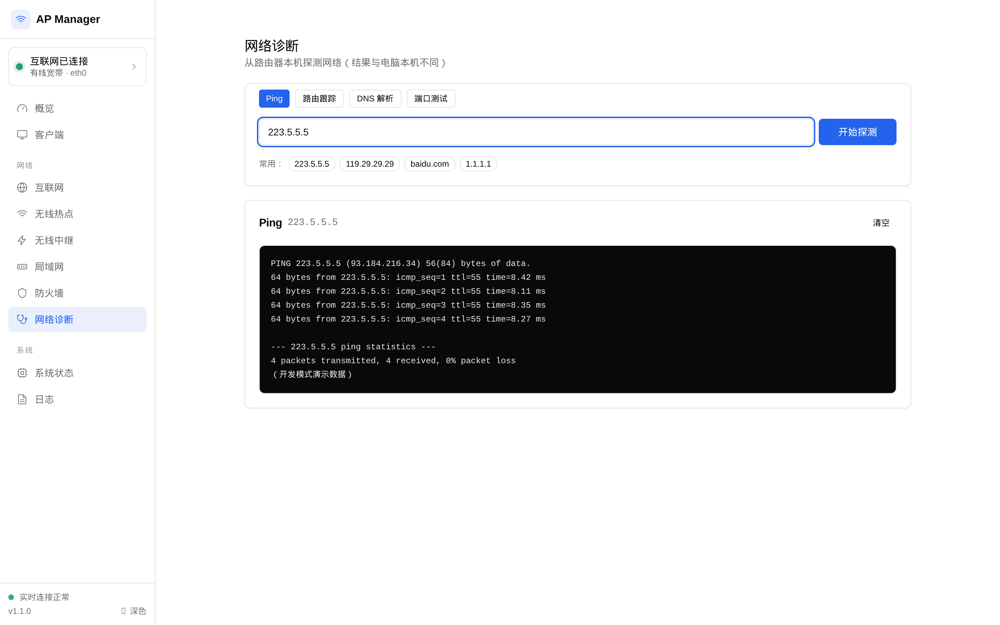
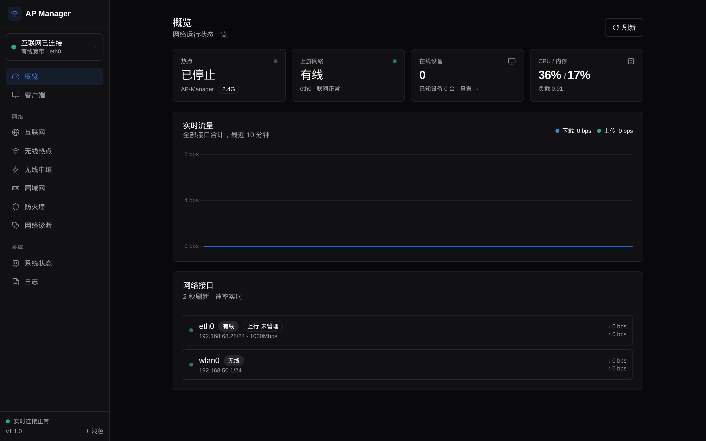

# AP Manager

**把一台 x86 Linux 小主机变成无线路由器。** Go 单二进制守护进程 + 内嵌 Web 管理界面，运行时零 Node/Python 依赖，离线可用。

> 设计哲学：**渲染原生配置，不重新实现协议**（同 drouter）。hostapd / dnsmasq / nftables / pppd 等 Debian 维护的上游服务负责实际工作，apmanager 只做编排：期望态配置 → 语法预检 → 原子下发 → 60 秒确认窗口内自动回滚。删掉本面板，系统仍是一台配置完好的 Linux 路由器。

| 概览 | 网口面板 | 防火墙 | 网络诊断 |
|---|---|---|---|
|  |  |  |  |

## 功能特性

### 网络
- **网络模式**（GL.iNet 式）：路由模式 / AP 接入点 / 无线扩展（引导至中继）/ WDS（如实标注未实现），侧栏卡片一键切换，模式随拓扑一起进入 3 分钟确认窗口
- **互联网（WAN）**：DHCP / 静态 IP / **PPPoE 拨号**（pppd + rp-pppoe，断线自动重拨、拨通接管默认路由）；连接状态、网关、DNS 一目了然
- **无线热点**：hostapd；WPA2/WPA3/混合；2.4G/5G、信道（含 ACS）、频宽、隐藏 SSID；硬件能力自动探测，不支持的选项直接禁用并说明原因；手机扫码连接
- **无线中继**：wpa_supplicant 扫描、多上游按优先级自动切换、断线指数退避重连
- **局域网**：网口可视化面板（RJ45 插座图、角色着色、插线高亮、悬停看地址/速率）；多 LAN 段（一桥一子网一池）、访客隔离
- **防火墙**：端口转发（TCP/UDP/TCP+UDP）、开放端口、DMZ 主机、UPnP/NAT-PMP（miniupnpd 托管）；区域隔离矩阵；只操作自建 `apmanager` nftables 表
- **DNS 上游**：手动指定或自动跟随上级，保存即重渲染 dnsmasq

### 设备与服务
- **客户端管理**：DHCP 租约 + 邻居表 + hostapd 在线列表聚合；备注、按设备上下行限速（tc HTB）、踢下线、MAC 拉黑、**网络唤醒（WOL）**
- **网络诊断**：Ping / 路由跟踪 / DNS 解析 / TCP 端口探测，从路由器本机执行（与电脑本机结果不同）；互联网页提供一键快捷诊断
- **实时性**：SSE 推送全部状态，概览流量图 Chart.js 惰性加载
- **系统**：管理密码（bcrypt + 首跑强制改密）、每日定时重启、重启设备、日志 + 子进程诊断面板、明暗主题、移动端适配

## 安全设计

- **安全应用事务**：网口拓扑 / 网络模式变更前自动快照 → 应用 → **3 分钟确认窗口**内未确认自动回滚（`systemd-run` 兜底，守护进程被杀也能恢复），改坏网络不用怕
- **特权收敛**：所有 root 操作集中在 `internal/priv`，支持 `--dry-run` 演练与审计日志
- **开发模式**：`--dev` 全部特权调用打桩，UI 开发不碰真实系统
- nftables 只操作自建 `table inet apmanager`，绝不触碰系统其他规则

## 硬件与系统要求

| 项目 | 要求 |
|---|---|
| 架构 | x86_64（`make release` 可交叉编译 arm64） |
| 系统 | Debian 11+ / Ubuntu 20.04+（其他发行版 `install-deps.sh` 会探测 apt/dnf/pacman/zypper） |
| 无线网卡 | 需支持 **AP 模式**（`iw list` 查看）；已实测 RTL8821CE；PPPoE 需 `ppp` 包 |
| 内存/磁盘 | 128MB 内存即可；二进制 ~9MB |
| 权限 | root（systemd 服务） |

## 快速开始

```bash
# 1. 系统依赖（hostapd dnsmasq nftables iw ethtool ppp；自动探测包管理器）
sudo ./scripts/install-deps.sh

# 2. 构建并安装（二进制 → /usr/local/bin + systemd 单元 + 开机自启）
make build
sudo ./scripts/install.sh

# 3. 打开管理界面 http://<本机IP>:28080
#    首跑初始密码在控制台，同时存于 /var/lib/apmanager/state.json.initial_password（首次登录强制修改）
```

## 从源码构建

```bash
# 依赖：Go 1.22+、Tailwind CSS v3.4 独立 CLI（bin/tailwindcss，见 scripts/install-deps.sh）
make build    # tailwind 生成 web/dist/app.css + go build -o bin/apmanager
make release  # CGO_ENABLED=0 交叉编译
make check    # go vet + embed 资源完整性
make dev      # 本机开发模式（假数据驱动 UI，不动系统，非 root 可跑）
```

前端为单页应用：Tailwind CSS（shadcn 风格设计 token）+ 原生 Alpine.js + SSE，JS 依赖（Alpine/Chart.js）全部本地化在 `web/vendor/`，**运行时不依赖任何 CDN**，最终经 `go:embed` 打进单个二进制。

## 配置说明

配置文件：`/etc/apmanager/config.yaml`（首次启动自动生成，GUI 修改会写回）

```yaml
network_mode: router          # router | ap（GL.iNet 式网络模式）
ap:
  enabled: true
  interface: wlp1s0
  ssid: Home
  password: "********"
  security: wpa2wpa3          # wpa2 | wpa3 | wpa2wpa3
  band: 2g
  channel: 6                  # 0 = 自动（ACS）
ports:
  - { name: eth0, role: wan, wan: { mode: dhcp } }   # dhcp | static | pppoe
  - { name: eth1, role: lan, bridge: br-lan }
lan:
  - name: home
    bridge: br-lan
    subnet: 192.168.50.1/24
    dhcp: { pool: [192.168.50.100, 192.168.50.200], lease_hours: 12 }
    isolation: false
firewall:
  port_forwards:
    - { name: nas-web, proto: tcp, wan_port: 8080, dest_ip: 192.168.50.10, dest_port: 80, enabled: true }
  open_ports:
    - { name: wireguard, proto: udp, port: 51820, enabled: false }
  dmz: { enabled: false, ip: "" }
  upnp_enabled: false         # UPnP/NAT-PMP（需 miniupnpd）
dns:
  upstream: []                # 空 = 自动跟随上级；指定后 dnsmasq 按此转发
system:
  reboot_at: ""               # 每日定时重启 HH:MM，空 = 禁用
admin: { port: 8080, bind: "0.0.0.0" }
```

## 架构

```
Web UI (Tailwind + Alpine.js + SSE, go:embed 单二进制)
  └─ HTTP API (net/http, REST + SSE)
      └─ Go 守护进程
          ├─ ap       hostapd 生命周期 / 配置渲染 / ctrl 控制接口
          ├─ relay    wpa_supplicant / 扫描 / 自动重连
          ├─ ethport  接口角色 / WAN/LAN / 桥 / 网络模式 / 安全应用事务
          ├─ netrt    dnsmasq 渲染 / nftables 区域策略+防火墙 / 上游探测
          ├─ diag     路由器侧网络诊断（ping/trace/dns/tcp）
          ├─ upnp     miniupnpd 托管（UPnP/NAT-PMP）
          ├─ wol      网络唤醒魔术包
          ├─ devices  设备聚合 / tc 限速 / ACL
          ├─ system   会话 / 状态采样 / 日志环 / 定时重启
          └─ priv     ★ 唯一特权层（exec / netlink / nft / tc，审计 + dry-run）
```

## 已知限制

- **AP + STA 并发**：RTL8821CE（rtw88）实测驱动强制互斥（EBUSY）——单卡"无线扩展"时热点会停止，完整扩展器需支持并发的网卡（MT7921 等）或第二片无线网卡
- **IPv6** 未支持（架构预留）
- **WDS** 未实现（模态框内如实置灰）
- 管理界面假设部署在可信内网；若上行口为公网直连，请务必配置防火墙限制管理端口

## 常见问题

<details>
<summary>WiFi 频繁掉线（RTL8821CE）</summary>

确认 `/etc/modprobe.d/rtw88.conf` 存在且内容为 `options rtw88_pci disable_aspm=1`（`install-deps.sh` 自动写入），重启生效。
</details>

<details>
<summary>改了网口角色把自己断网了</summary>

安全应用机制会在 3 分钟后自动回滚，等待即可；重启也会恢复到最近一次确认的配置。
</details>

<details>
<summary>PPPoE 拨号失败</summary>

确认宽带账号密码、网口直连光猫、`ppp` 包已安装（`install-deps.sh` 会装）；托管进程状态与 pppd 输出见「日志」页子进程诊断面板。
</details>

## 致谢

设计参考了同领域的优秀项目：[drouter](https://github.com/liuzhuohua/drouter)（渲染原生配置的哲学、DDNS/UPnP/WOL 功能思路）与 [Landscape](https://github.com/ThisSeanZhang/landscape)（Linux 软路由的更多可能性）。

## License

[MIT](LICENSE)
